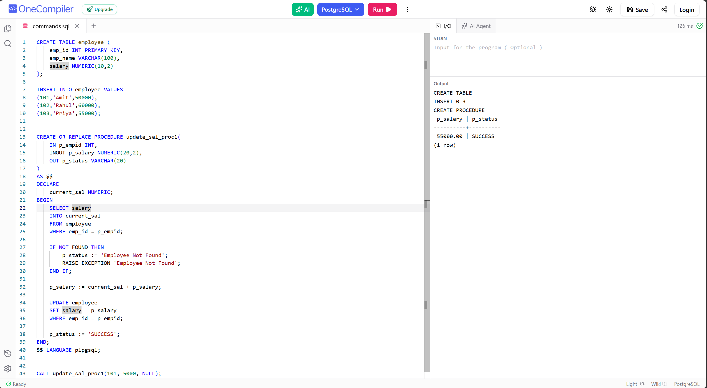

# Experiment 8.1

**Name:** Bhavesh Chawla  
**UID:** 24BCS10079

## Aim

To create a stored procedure in PL/pgSQL that updates the salary of an employee using an input amount and returns a status message.

## Question

Create an `employee` table with employee details, insert sample records, and write a procedure `update_sal_proc` that accepts an employee ID, an increment value, and an output status. The procedure should fetch the current salary, raise an exception if the employee is not found, add the input salary to the current salary, update the record, and return `SUCCESS`.

## Theory

A stored procedure is a named block of PL/pgSQL code that can accept parameters and execute database operations. In this example:

- `IN p_empid` receives the employee ID.
- `INOUT p_salary` receives the amount to be added and returns the updated salary.
- `OUT p_status` returns the result of the procedure.

The procedure uses a `SELECT ... INTO` statement to fetch the current salary. If the employee does not exist, it raises an exception. Otherwise, it updates the employee's `salary` by adding the incoming value and sets the status to `SUCCESS`.

## SQL Query Used

```sql
CREATE TABLE employee (
    emp_id INT PRIMARY KEY,
    emp_name VARCHAR(100),
    salary NUMERIC(10,2)
);

INSERT INTO employee VALUES
(101, 'Amit', 5000.00),
(102, 'Rahul', 6000.00),
(103, 'Priya', 5500.00);

CREATE OR REPLACE PROCEDURE update_sal_proc(
    IN p_empid INT,
    INOUT p_salary NUMERIC(20,2),
    OUT p_status VARCHAR(20)
)
LANGUAGE plpgsql
AS $$
DECLARE
    current_sal NUMERIC;
BEGIN
    SELECT salary
    INTO current_sal
    FROM employee
    WHERE emp_id = p_empid;

    IF NOT FOUND THEN
        p_status := 'Employee Not Found';
        RAISE EXCEPTION 'Employee Not Found';
    END IF;

    p_salary := current_sal + p_salary;

    UPDATE employee
    SET salary = p_salary
    WHERE emp_id = p_empid;

    p_status := 'SUCCESS';
END;
$$;

CALL update_sal_proc(101, 5000, NULL);
```

## Output

```text
CREATE TABLE
INSERT 0 3
CREATE PROCEDURE

p_salary | p_status
-----------------
5500.00 | SUCCESS
(1 row)
```

## Output Screenshot



## Image Explanation

The screenshot shows the SQL editor where the `employee` table is created, the records are inserted, and the `update_sal_proc` procedure is defined. In the procedure body, the code reads the current salary using `SELECT ... INTO`, checks for the employee, updates the salary by adding the input value, and sets `p_status` to `SUCCESS`. The output panel displays the successful execution and result `5500.00 | SUCCESS`.

## Result

The stored procedure was created successfully, executed without errors, and updated the salary of the required employee. The procedure correctly returned the updated salary value and the `SUCCESS` status.
